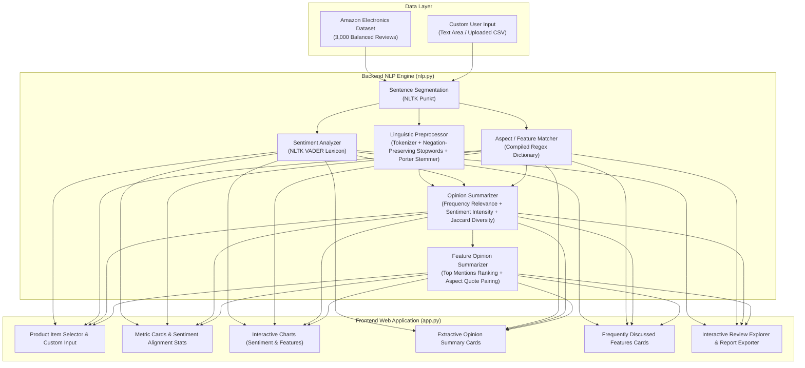

# ReviewPulse: Comprehensive Technical Documentation
**Automatic Opinion Summarization from Customer Reviews**

---

## 1. Executive Summary & Project Overview

### 1.1 Problem Statement
In e-commerce platforms, popular products often accumulate hundreds or thousands of customer reviews. Prospective buyers and product managers cannot realistically read all reviews to understand consumer sentiment. 

The objective of **ReviewPulse** is to:
1. Automatically analyze customer reviews at scale.
2. Generate concise, explainable summaries of **positive opinions** (*what customers liked*).
3. Generate concise, explainable summaries of **negative opinions** (*what customers disliked*).
4. Identify and summarize opinions on **frequently discussed product features** (e.g., Battery, Build Quality, Price, Display).

### 1.2 Core Design Philosophy: Explainable Extractive NLP
Modern generative AI (LLMs like GPT-4 or T5) often suffers from **hallucinations**, high computational costs, GPU requirements, network latency, and non-deterministic outputs. 

ReviewPulse adopts an **Explainable Extractive NLP Architecture**:
* **100% Truthful Quotes**: Summaries consist of real sentences written by verified customers, referenced back to their original line numbers and star ratings.
* **Lightweight & High-Throughput**: Processes thousands of reviews in seconds on standard CPU hardware.
* **Zero External Dependencies**: Operates completely offline with bundled NLTK data and VADER sentiment lexicons—no API keys or external servers required.
* **Deterministic & Auditable**: Every metric, sentiment label, and sentence ranking has a clear mathematical formulation.

---

## 2. System Architecture



---

## 3. Data Pipeline & Sampling Architecture (`prepare_data.py`)

### 3.1 Provenance
* **Source Dataset**: Amazon Reviews (2014 Electronics 5-core subset), verified UTF-8 JSON Lines (1,689,188 total records, ~1.48 GB).
* **Target Output**: `data/reviews_sample.csv` (3,000 reviews, 20 products, exactly 150 reviews per product).

### 3.2 Two-Pass Streaming Reservoir Sampling
To avoid loading a 1.5 GB dataset into memory, `prepare_data.py` executes a **two-pass streaming algorithm**:

1. **Pass 1 (Validation & Eligibility Discovery)**:
   * Validates JSON structure, non-empty text, valid dates (`%m %d, %Y`), and star ratings ($1 \le \text{overall} \le 5$).
   * Discards anonymous or invalid records.
   * Tracks review counts per product and per star rating.
   * Filters products having at least 150 reviews and $\ge 30$ reviews in **every** star rating tier (1 to 5).
   * Identifies the top 20 candidate products (ASINs) with the highest review volume.

2. **Pass 2 (Deduplication & Balanced Reservoir Sampling)**:
   * Samples exactly 30 unique reviews per star rating for each of the 20 products ($30 \times 5 = 150$ reviews per product; $150 \times 20 = 3,000$ reviews total).
   * **Deduplication**: Casefolds and normalizes whitespace, computing a SHA-256 fingerprint for each text. Identical duplicate reviews across products are discarded.
   * **Reservoir Algorithm**: Uses seeded random sampling (`seed=42`) ensuring mathematical reproducibility.

### 3.3 Dataset Schema (`data/reviews_sample.csv`)

| Column | Type | Description |
| :--- | :--- | :--- |
| `asin` | String | Amazon Standard Identification Number (Product ID) |
| `reviewText` | String | Cleaned, whitespace-normalized customer review body |
| `overall` | Integer | Customer rating from 1 to 5 stars |
| `summary` | String | Review headline or short summary text |
| `reviewTime` | String | ISO formatted date (`YYYY-MM-DD`) |
| `source_line` | Integer | Original line number in the source JSONL file for provenance |

---

## 4. Backend Architecture & NLP Pipeline (`nlp.py`)

The core analytical pipeline is encapsulated inside the `ReviewNLP` class.

### 4.1 Linguistic Preprocessing
Linguistic preprocessing converts raw text into normalized tokens for frequency analysis while protecting sentiment-bearing words:

1. **Token Extraction**:
   Uses `nltk.tokenize.RegexpTokenizer(r"[A-Za-z]+(?:'[A-Za-z]+)?")` to isolate alphabetical words and internal apostrophes (e.g. `doesn't`, `it's`).
2. **Negation-Preserving Stopword Removal**:
   Standard NLTK English stopwords list contains 179 words. Naive removal strips critical negation tokens. The backend explicitly keeps negation:
   $$\text{Stopwords} = \text{Stopwords}_{\text{NLTK}} \setminus \{\text{"no", "nor", "not", "never"}\}$$
3. **Morphological Stemming**:
   Applies `nltk.stem.PorterStemmer()` to map inflectional forms to common roots (e.g., `batteries` $\rightarrow$ `batteri`, `performance` $\rightarrow$ `perform`).

### 4.2 VADER Sentiment Analysis Model
Sentiment scoring uses **VADER** (*Valence Aware Dictionary and sEntiment Reasoner*), a rule-based lexicon optimized for consumer reviews and social media.

* **Preservation of Original Text**: VADER runs on the **unstemmed, original text** to preserve punctuation (`!`), capitalization (`GREAT`), and grammatical modifiers.
* **Compound Score Formulation**:
  VADER computes positive, neutral, and negative valence scores, then aggregates them into a normalized compound score $C \in [-1.0, +1.0]$:
  $$C = \frac{x}{\sqrt{x^2 + \alpha}}$$
  where $x$ is the sum of valence scores of lexicon words and $\alpha = 15$ is a normalization constant.
* **Classification Thresholds**:
  $$\text{Sentiment}(C) = \begin{cases} 
  \textbf{Positive} & \text{if } C \ge +0.05 \\ 
  \textbf{Negative} & \text{if } C \le -0.05 \\ 
  \textbf{Neutral} & \text{otherwise} 
  \end{cases}$$

### 4.3 Aspect / Feature Detection
The system tracks 9 primary hardware and consumer electronics aspects via compiled regular expression dictionaries:

```python
FEATURES = {
    "Battery": r"\b(?:batter(?:y|ies)|charg(?:e|er|ing|ed))\b",
    "Display": r"\b(?:screen|display|monitor|resolution)\b",
    "Sound": r"\b(?:sound|audio|bass|volume|speakers?|mic(?:rophone)?)\b",
    "Camera": r"\b(?:camera|photos?|pictures?|lens|video)\b",
    "Performance": r"\b(?:performance|speed|fast|slow|lag|responsive)\b",
    "Connectivity": r"\b(?:wi-?fi|bluetooth|connection|connectivity|pairing)\b",
    "Build quality": r"\b(?:durable|durability|build quality|plastic|sturdy|flimsy|broke|broken)\b",
    "Price": r"\b(?:price|cost|expensive|cheap|value|worth|affordable)\b",
    "Comfort": r"\b(?:comfort|comfortable|uncomfortable|fit)\b",
}
```

A sentence mentioning any keyword inherits that aspect tag. Features mentioned in each review are also aggregated and attached to the review level.

### 4.4 Extractive Opinion Summarization Algorithm
The `summarize(sentences, sentiment, limit=3)` method implements a multi-factor ranking algorithm:

1. **Candidate Filtering**:
   * Must match target sentiment polarity.
   * Standard length constraint: $6 \le \text{word count} \le 65$.
   * **Adaptive Fallback**: If fewer than `limit` candidates exist, automatically relaxes the minimum threshold to $\ge 3$ words so valid concise opinions are not lost.

2. **Scoring Function**:
   For candidate sentence $s$, its importance score is computed as:
   $$\text{Rank}(s) = \text{Relevance}(s) \times \Big(1 + |C(s)|\Big) \times \text{FeatureBonus}(s)$$
   where:
   * $\text{Relevance}(s) = \frac{\sum_{t \in \text{Tokens}(s)} \text{Freq}(t)}{\max(|\text{Tokens}(s)|, 1)}$ reflects how well the sentence uses vocabulary shared by many customers.
   * $\Big(1 + |C(s)|\Big)$ prioritizes sentences with strong, confident polarity over marginal sentiment.
   * $\text{FeatureBonus}(s) = 1.2$ if the sentence mentions at least one detected product aspect (otherwise $1.0$).

3. **Diversity & De-duplication (Jaccard Distance)**:
   Quotes are evaluated in descending rank order. A candidate quote $A$ is rejected if its token Jaccard similarity with an already-selected quote $B$ exceeds 0.6:
   $$J(A, B) = \frac{|\text{Tokens}(A) \cap \text{Tokens}(B)|}{|\text{Tokens}(A) \cup \text{Tokens}(B)|} > 0.6$$
   Furthermore, only **one sentence per customer review** is permitted to ensure broad reviewer representation.

### 4.5 Frequently Discussed Features Summarizer (`summarize_features`)
1. Aggregates total mentions ($\text{Positive} + \text{Neutral} + \text{Negative}$) for all detected features.
2. Identifies the top $N$ (default 3) features sorted by total discussion volume.
3. Computes polarity breakdown ratios:
   $$\text{Pos Ratio} = \frac{\text{Positive Mentions}}{\text{Total Mentions}} \times 100\%$$
   $$\text{Neg Ratio} = \frac{\text{Negative Mentions}}{\text{Total Mentions}} \times 100\%$$
4. Queries the summarizer specifically on sentences matching that feature to extract:
   * **Customer Praise**: Best positive quote regarding that feature.
   * **Customer Concern**: Best negative quote regarding that feature.

---

## 5. Frontend Architecture & User Interface (`app.py`)

Built with **Streamlit**, the application provides a modern, reactive interface with zero client-side setup.

### 5.1 Caching Architecture
To guarantee split-second page renders and eliminate redundant NLP computations:
* `@st.cache_resource`: Persists the `ReviewNLP` instance across user sessions.
* `@st.cache_data`: Caches the sample dataset CSV in memory.
* `@st.cache_data(max_entries=20)`: Caches computed analysis results (DataFrame, feature cross-tab, sentence rows) per product ASIN.

### 5.2 Input Modalities
1. **Preloaded Product Dataset (20 Electronics ASINs)**:
   Features a friendly dropdown mapping cryptic ASINs to descriptive product names:
   * `B0002L5R78 — HDMI Cable (Audio / Video)`
   * `B0074BW614 — Kindle Fire HD 7" Tablet`
   * `B007WTAJTO — SanDisk Ultra MicroSD Card`
   * `B005DKZTMG — Logitech Wireless Keyboard & Mouse`
   *(and 16 other popular products)*
2. **Custom Reviews Input**:
   * **Type / Paste Reviews**: Includes interactive presets (*Wireless Headphones*, *Smart 4K TV*, *Mechanical Keyboard*) and custom product name naming.
   * **CSV Upload Mode**: Upload any `.csv` file. The app automatically scans column headers for review keywords (`reviewText`, `comment`, `text`, `feedback`), prompts confirmation, and summarizes the dataset.

### 5.3 Key Visual Components
1. **Product Item Banner**: High-contrast gradient banner prominently displaying the active product name, identifier, and total review count.
2. **Metric Grid**: Displays Reviews Analyzed, Positive %, Neutral %, and Negative % with visual trend delta tags.
3. **Sentiment vs. Star Rating Polarity Agreement**: Computes empirical alignment between VADER labels and numerical stars ($4\text{–}5\star \rightarrow \text{Positive}$, $1\text{–}2\star \rightarrow \text{Negative}$, $3\star \rightarrow \text{Neutral}$).
4. **Visual Analytics Charts**:
   * Review Sentiment Bar Chart (Colored teal `#167D8D`).
   * Stacked Feature Opinions Chart (Feature mentions broken down by Positive, Neutral, Negative).
5. **Opinion Summary Cards**: Styled callout boxes displaying quote text, line number, star rating, VADER compound score, and matched feature tags.
6. **Frequently Discussed Features Summary**: 3-column cards displaying mention counts, positive/negative percentage bars, and specific Customer Praise vs. Customer Concern quotes.
7. **One-Click Report Export**: `st.download_button` exports an executive plain-text report (`opinion_summary_<product>.txt`).
8. **Multi-Dimensional Review Explorer**: Interactive table with sentiment filter, feature filter, and preprocessed token inspector.

---

## 6. Project Directory & File Reference

```text
reviewpulse-main/
│
├── .streamlit/
│   └── config.toml                  # Streamlit theming (palette #167D8D, typography)
│
├── data/
│   ├── README.md                    # Data provenance and terms note
│   ├── reviews_sample.csv           # 3,000 balanced Amazon Electronics reviews
│   └── reviews_sample.metadata.json # Hash checksums, seeds, and sampling metadata
│
├── nltk_data/                       # Pre-bundled offline NLTK resources
│   ├── corpora/stopwords/           # English stopwords list
│   └── sentiment/vader_lexicon.zip  # VADER sentiment intensity lexicon
│
├── app.py                           # Main Streamlit web application & UI
├── nlp.py                           # Backend NLP pipeline & summarization engine
├── prepare_data.py                  # Two-pass streaming sampling & preparation script
├── requirements.txt                 # Direct pip dependencies (streamlit, pandas, nltk)
├── README.md                        # Quickstart instructions and feature summary
├── DEVELOPMENT_LOG.md               # Chronological log of engineering decisions
└── DOCUMENTATION.md                 # Complete project documentation
```

---

## 7. Comprehensive Q&A (Project Evaluation & Viva Talking Points)

### Q1: Why use VADER instead of modern Transformer models (BERT, RoBERTa, Llama)?
* **Answer**: VADER is an explainable, rule-based model specifically calibrated for consumer reviews. It requires **no training**, zero GPU memory, executes in milliseconds, and preserves casing, punctuation, and negation nuance. For a responsive web dashboard analyzing thousands of reviews on standard computers, VADER provides the optimal trade-off between latency, interpretability, and accuracy.

### Q2: Why extractive summarization instead of abstractive LLM generation?
* **Answer**: Abstractive summarizers (like GPT-4 or T5) synthesize new text, which introduces the danger of **hallucinations** (e.g. inventing battery life hours or features not present in the reviews). Extractive summarization guarantees **100% factual fidelity** because every quote is a verbatim sentence written by an actual customer, complete with its original line number and star rating for auditability.

### Q3: How does the pipeline prevent negation errors (e.g., "not good")?
* **Answer**: Two safeguards are implemented:
  1. In linguistic preprocessing, words like *not*, *no*, *nor*, and *never* are explicitly excluded from stopword filtering.
  2. VADER receives the raw, unstemmed text directly, utilizing its built-in grammatical rules that handle tri-gram negation modifiers (*"not really that great"*).

### Q4: Why does VADER sentiment sometimes differ from customer star ratings?
* **Answer**: Numerical star ratings and linguistic sentiment measure different facets of user experience:
  * A customer may give a 1-star rating due to a shipping delay, yet write *"The HDMI cable itself works great"*. VADER correctly labels that sentence Positive.
  * A customer may write a sarcastic review or use idiomatic expressions (*"There is no reason to spend $50 on an expensive cord"*), which contains negative sentiment keywords despite reflecting a positive recommendation.
  * The dashboard explicitly reports this empirical alignment rate (typically 55%–85% on balanced rating strata) to demonstrate evaluation awareness.

### Q5: How are features detected without a trained Aspect-Based Sentiment Analysis (ABSA) model?
* **Answer**: The system uses high-precision regular expression dictionaries targeting 9 canonical consumer electronics dimensions. Sentences matching an aspect regex assign sentence-level sentiment to that aspect. While trained ABSA models can handle obscure phrasing, keyword dictionaries provide zero-latency, predictable, and explainable aspect extraction.

---

## 8. Deployment & Operational Guide

### 8.1 Running Locally
```powershell
# 1. Activate virtual environment
python -m venv .venv
.venv\Scripts\activate

# 2. Install dependencies
pip install -r requirements.txt

# 3. Launch application
streamlit run app.py
```

### 8.2 Deploying to Streamlit Community Cloud
1. Push the repository to GitHub (`GARVS0205/reviewpulse`).
2. Log into [share.streamlit.io](https://share.streamlit.io) using GitHub.
3. Click **Create app** $\rightarrow$ select repository `GARVS0205/reviewpulse`, branch `main`, and main file path `app.py`.
4. Deploy! The application uses bundled `nltk_data/` and requires zero API keys or environment secrets.
